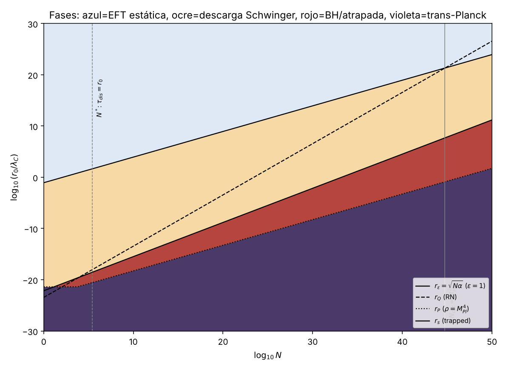
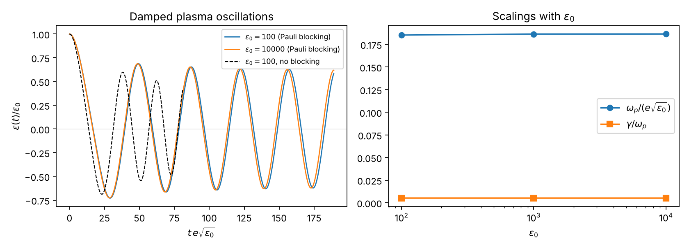
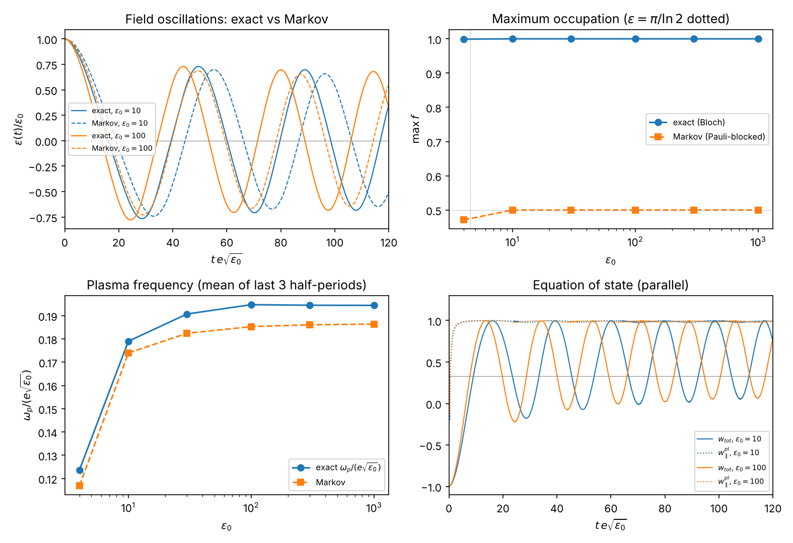

# Destino del campo eléctrico extremo más allá de la ruptura de la EFT estática
### Descarga de Schwinger, QED no perturbativa y atrapamiento gravitatorio en el sistema Einstein–Maxwell–Euler–Heisenberg

> Informe generado por `07_make_report.py`. **Todo número procede de `discovery_results.json` / `results.json`** (si una clave falta, la generación falla). Cada tesis cita el *gate* que la verifica (`04_*`, `05_*`, `06_*`); el total es 90 gates, todos PASS, de los cuales 21 son controles negativos que **deben** detectar un modelo alterado. Unidades: ħ=c=ε₀=m_e=1, longitudes en λ_C, ε ≡ eE/m_e², G=1/M_Pl².

## Abstract

La línea base (`03_integrate.py`) mostró que la EFT de Euler–Heisenberg truncada falla en ε=1 con ρ ≈ 1.67e-89 M_Pl⁴, muy por debajo de Planck. Aquí se estudia qué ocurre más allá de ese punto con tres herramientas: (A) el Lagrangiano de Euler–Heisenberg a un bucle con **tiempo propio exacto** (parte real e imaginaria), (B) una cinética de pares con retroacción en el régimen de campo localmente constante, y (C) el criterio de atrapamiento de la desigualdad de Penrose cargada. Resultados: (1) la QED a un bucle **no satura** el campo: crece logarítmicamente, `L = (E²/2)[1 − (α/3π) ln ε + …]`, y el polo de Landau está en log₁₀ ε_L = 562, frente a log₁₀ ε_Planck = 44.4: es inaccesible. El perfil interior es Reissner–Nordström con carga corrida (δr₊/r₊ = -1.191e-02 medido vs -1.230e-02 predicho), no el horizonte único tipo Schwarzschild que producen la extrapolación cuártica y Born–Infeld. (2) La descarga neutraliza el campo en **τ_discharge = κ/(e√(eE₀))**, κ = 13.5394, exponente medido -0.50001. (3) En el criterio de Penrose cargada la energía electrostática de un cascarón **se cancela exactamente**: atrapar exige masa no electromagnética, G·M_n ≥ R/2. De ahí se sigue que **la QED no es un censor universal del colapso**: no puede deshacer una superficie atrapada ni crearla desde energía de campo puro; lo que sí hace es destruir la carga neta en τ_dis, siempre más rápido que la caída libre de N masas en reposo para r₀ ≫ r₀* = 9.29e-18 l_P. (4) Con bloqueo de Pauli (Markov) el campo oscila durante ≥5 periodos con ω_p = 0.186 e√(eE₀), γ/ω_p = 0.0052 y energía conservada a 3e-06. (4b) **La cinética cuántica exacta (05c: Bloch/Bogoliubov acoplada a Maxwell, sin fuente ad hoc) elimina el techo f≤½ de Markov**: f_max = 0.999996 (ε₀=100) frente a 0.500; el primer cero llega 19 % antes (τ₀·e√ε₀ = 13.44 vs 16.67, a ε₀=10³), ω_p = 0.1944 e√(eE₀) (+4.3 % sobre Markov), γ/ω_p ≈ 0.0048, y el plasma de pares es un gas **colineal** (⟨w∥⟩ = 0.988, no 1/3). Se detectó además un factor 2 en el acoplo del encargo (C11). (5) La igualdad de Penrose cargada se **deriva dentro del repositorio** (θ₊=0 ⇔ 2GM_MS=R; M_ADM=M_MS+U_C; gate P10) para datos simétricos en el tiempo. Se dan el diagrama de fases en (N, r₀) y las leyes de escala. Lo que **no** se resuelve (colisiones/isotropización, transporte espacial, comparación con curvas publicadas) se declara en §6. **Novedad:** ver `NOVELTY_AUDIT.md`; L1 (masa de Misner–Sharp), la escala de plasma, el crecimiento logarítmico y la violación de DEC (anomalía de traza) son resultados conocidos que aquí se reproducen y verifican formalmente; el valor del trabajo es de síntesis cuantitativa y verificación, no de descubrimiento.

## 1. Línea base y qué pregunta queda abierta

`03_integrate.py` integró el sistema cuártico hacia el centro y se detuvo por ε≥1 (o por escala de variación del campo < λ_C) sin llegar a Planck. Dos hechos se heredan: N_crit = M_Pl²/m_e² = 5.71e+44 (gate **P5**, simbólico: r_Q = r_ε) y ningún horizonte RN cae dentro de la EFT estática si N < N_crit. La pregunta es qué hay en r < r_stop.

*Corrección de rotulado heredado:* `eeh.py:schwinger_rate` es Γ_vac = 2 Im L₁ (decaimiento del vacío, todos los términos de la serie positivos para espinores), **no** el número medio de pares, que es sólo el término n=1 (`qed1loop.pair_rate`). Los criterios de parada del baseline no cambian (usan ε), pero el modelo dinámico usa la tasa correcta. Verificado: gate **N1** (04): |Im L₁(rayo)/serie de Schwinger − 1| < 10⁻⁸.

## 2. Formulación Lagrangiana y cinética

### 2.1 Electrodinámica no lineal estática acoplada (Rama A)
Para **cualquier** L(E) (E=√(g/f)Φ′; X=−2E²), el CAS deriva (`04`, gates **S1–S4**): `T^t_t = T^r_r = −ρ`, `ρ = E L′ − L`, `p_⊥ = T^θ_θ = L`; la primera integral de Maxwell `r² L′(E) = Q/4π`; `y′ = 8πG r² ρ` con f=g=1−y/r (**S2**); y la conservación `ρ′ + (2/r)(ρ+p_⊥) = 0` (**S4**). El control **C1** confirma que un tensor erróneo (p_⊥=L/2) deja residuo −L/r ≠ 0.

Modelos comparados: Maxwell (RN); Euler–Heisenberg cuártico; **QED a un bucle exacto**
`L₁(x) = −(1/8π²) ∫₀^∞ ds/s³ e^{−s}[ x s cot(x s) − 1 + (x s)²/3 ]`, x=eE=ε, evaluado sobre el rayo s=ρe^{−iπ/4} (los polos de cot están en el eje real); y Born–Infeld calibrado `b² = 1/(32c)` (**S5**). Verificaciones: el desarrollo en x reproduce `4cE⁴` con c=α²/90 (**S6**, simbólico) y la correspondencia ε≪1 con el baseline es L₁/(4cE⁴)−1 ∝ ε^2.00 (**N2**); Im L₁ coincide con la serie de Schwinger a ~10⁻¹⁴ (**N1**); la pendiente de campo fuerte es −1/(24π²) con deriva de la constante K=-0.763969 < 10⁻⁹ (**N3**).

### 2.2 Cinética de pares con retroacción (Rama B)
Campo homogéneo, x=eE(t), aproximación de campo localmente constante:

`ẋ = −2e² [ ∫₀ᵗ dt′ Γ(x′)⟨v⟩ + Γ(x)⟨m_⊥⟩/x ]`, `p(t,t′)=∫_{t′}ᵗ x dt″`, `v=p/√(p²+m_⊥²)`, `m_⊥²=1+x s/π` (s~Exp(1), 8 nodos Gauss–Laguerre, **N0**), `Γ(x)=x²/(4π³)e^{−π/x}`.

El primer término es la corriente de conducción y el segundo la de polarización (energía 2m_⊥ de cada par). El CAS verifica: (**D1**) `∇_μT^{μν}_EM = F^ν{}_λ J^λ` en Minkowski esférico con A_t(t,r), A_r(t,r) arbitrarios, de donde `∇_μT^{μν}_matter = −F^ν{}_λ J^λ` si el total se conserva; (**D2**) `d/dt(E²/2 + ρ_pl) = 0` como identidad exacta (Leibniz sobre cohortes). Los controles **C1/C2** (sin j_pol; j_cond con signo invertido) rompen la identidad; **C3/C4** lo detectan en el integrador (|ΔE|/E₀ = 2.9·10⁻² y 1.7·10³³ frente a ~10⁻⁵).

**Validez declarada (05):** hasta el *primer cero* del campo (las cohortes no se recruzan: sin bloqueo de Pauli); la extensión §2.2b (`05b`) lo levanta dentro del modelo de Markov; LCFA con t_form/τ₀ ≈ e/κ = 0.022 ≪ 1 (**N5**); región ≥ 3 longitudes de formación ⇒ N ≥ 9/α = 1233.

### 2.2b Extensión cinética con bloqueo de Pauli a través de múltiples cruces (`05b_plasma_oscillations.py`)
Malla en momento canónico P y momento transversal p_⊥ (Gauss–Legendre), con ocupación f(P,p_⊥,t) y momento cinético p=P+Φ(t), Φ̇=x:

`∂ₜf = (1−2f) S`, `S = |x| e^{−π m_⊥²/|x|} G_σ(p)`, `ẋ = −2e²[ Σ W f p/ω + Σ W ω (1−2f) S / x ]`, `ρ_pl = 2 Σ W f ω`.

El CAS verifica (**K1**) que `d/dt(E²/2+ρ_pl) = 0` es una identidad exacta *con* el factor (1−2f) también en la corriente de polarización (el control **C5** muestra que omitirlo deja el residuo −4ω S f ≠ 0), y (**K2**) que el bloqueo de Markov resuelve `f=(1−e^{−2∫S})/2 ∈ [0,½)`: **desde el vacío f no supera ½**. Esto es una **limitación del modelo**: la QKE exacta de campo constante da f=e^{−π m_⊥²/ε}, que supera ½ para ε>4.5 y p_⊥→0 (la regla de un cruce es f=(1−e^{−2f₀})/2; para f₀=0.9 da 0.46 de la ocupación exacta). Integrador adaptativo DOP853 con eventos de cruce por cero.

### 2.2c Cinética cuántica exacta no markoviana (`05c_quantum_vlasov_exact.py`)
Para cada modo (P, s=p_⊥²), `p=P+Φ(t)`, `Φ̇=x=eE`, `m_⊥²=1+s`, `ω=√(p²+m_⊥²)`, el sistema de Bloch/Bogoliubov exacto de Dirac en E(t) homogéneo es

`ḟ = (λ/2) u`, `u̇ = λ(1−2f) − 2ω v`, `v̇ = 2ω u`, `λ = x m_⊥/ω²`, `ẋ = −2e² Σ W [ (p/ω) f + (m_⊥/(2ω)) u ]`,

con `ρ_pl = 2 Σ W ω f` y `P_∥ = Σ W p [2(p/ω) f + (m_⊥/ω) u]` (Hellmann–Feynman). **Sin** fuente ad hoc, **sin** LCFA y **sin** ancho σ. Gates simbólicos: **Q0** deriva las ecuaciones desde `n' = 2h×n` con `H = pσ_z + m_⊥σ_x` (y la velocidad y la energía sustraídas del vacío); **Q1** `d/dt[(1−2f)²+u²+v²] = 0` idénticamente ⇒ desde el vacío `0≤f≤1` sin truncar en ½ (control **C9**: sin el ½ de `ḟ` la pureza se rompe); **Q2** `d/dt(E²/2+ρ_pl) = 0` idénticamente (control **C10**: sin la corriente de polarización el residuo es `W x m_⊥ u/ω ≠ 0`); **Q4** identidad de traza `ρ−P_∥−2P_⊥ = Σ W m²(2f−pu/m_⊥)/ω`; **Q3a** `f=½ ⇔ ε = π/ln2 = 4.53236`. Numéricamente, **Q3** el integrador reproduce `f_∞ = e^{−πm_⊥²/eE}` con error relativo ≤ 4.1e-07 en 8 casos (hasta f=0.9691 > ½), y **Q3b** el núcleo C (RK4, OpenMP) hasta 2.1e-06.

**Corrección al encargo (hallazgo propio, gate C11):** el acoplo escrito en el encargo, `ḟ=(eE m/ω²)u`, `u̇=(2eE m/ω²)(1−2f)−2ωv`, es el doble del derivado en Q0. Conserva pureza y energía (con la corriente `2e[(p/ω)f+(m/ω)u]`), así que Q1/Q2 **no** lo distinguen, pero **no** reproduce Schwinger–Nikishov: a eE=10, m_⊥=1 da f_∞ = 0.2942 en vez de 0.7304. En el plasma acoplado el factor 2 desplaza τ₀·e√ε₀ a 15.18 (control **C14**). El signo del residuo de C10 para c=2 también difiere del escrito (el residuo de dE_tot/dt sin esa corriente es `+2eE m_⊥ u/ω` por modo).

### 2.3 Criterio de atrapamiento (Rama C)
**Demostración interna (sin teoremas externos), gate `P10_misner_sharp_symbolic` (16 subcomprobaciones):** (a) en coordenadas de doble nulo `ds²=−2e^{2σ}du dv+R²dΩ²`, con `M_MS=(R/2G)(1−g^{ab}∂ₐR∂_bR)`, SymPy establece `1−2GM_MS/R = −(R²e^{−2σ}/2) θ_ℓ θ_n`: **θ₊=0 ⇔ 2G M_MS = R** y la superficie atrapada es 2G M_MS>R; (b) para datos simétricos en el tiempo (K_ij=0) el vínculo hamiltoniano sale de calcular `G_{ab}n^an^b = 2G m′/r²`, **independiente de las segundas derivadas temporales**, es decir `m′=4πr²ρ`; (c) la ley de Gauss `r²E_orth=cte` es independiente de la métrica, así que `M_ADM = M_MS(R) + ∫_R^∞ 4πr²ρ_EM dr = M_MS(R) + Q²/(8πR)` y la métrica exterior *resulta* Reissner–Nordström; (d) en θ₊=0, `G M_ADM = (R + r_Q²/R)/2` (igualdad de Penrose cargada **derivada**) y con `M_MS(R)=M_n` el término electrostático se cancela idénticamente: `G(M_n+U_C) − (R+r_Q²/R)/2 = G M_n − R/2`; la materia exterior sin carga con ρ≥0 sólo suma masa (desigualdad). El control **C4** confirma que un factor erróneo en M_MS, en el vínculo (m′=2πr²ρ) o en U_C se detecta.
**Alcance probado:** datos esféricos simétricos en el tiempo, ρ≥0, sin materia cargada exterior a la superficie. **No probado aquí:** el caso dinámico general (ecuaciones de Misner–Sharp completas) ni la persistencia posterior de superficies atrapadas.
**Corrección exacta a un bucle de U_C (gate `P11_U_QED_exacta`):** `U_QED(R) = 2π a^{3/2} ∫₀^{D_R} H(D) D^{−5/2} dD`, `H=E D−L` exacta a un bucle, con `U_QED/U_C − 1 = 7.047e-02` en R=r_Q (N=10⁶) y concordancia con la integral directa en r de 8.9e-14; la pendiente respecto de ln ε es 7.8527e-04 (ln ε∈[9,23]) → 8.1870e-04 (ln ε∈[18,60]) frente a α/3π=7.7427e-04 (el exceso es el logaritmo subdominante O(α ln ε)). Con Maxwell se recupera Q²/(8πR) y con el término cuártico la corrección −16πc a⁴/(5R⁵) (la usada en 04).
Con N electrones confinados (masa en reposo + energía de Fermi ultrarrelativista) el radio de atrapamiento es la raíz positiva `r_s(N)` de `r = 2G(N + (3/4)(9π/4)^{1/3}N^{4/3}/r)` (**P4**).

## 3. Leyes de escala y resultados deducidos

**L1 (Cancelación de Coulomb).** El atrapamiento de un cascarón cargado no depende de Q: exige G M_n ≥ R/2 (P2, P3). *Corolario:* una superficie atrapada formada sólo con energía de campo es imposible (`verdict.pure_field_trapped_possible = False`). La razón carga/masa de N electrones es z² = α M_Pl² = 4.17e+42 veces la extremal, y una carga unitaria extremal pesaría 2.04e+21 m_e.

**L2 (Tiempo de descarga).** `τ_discharge = κ /(e√(eE₀))` con κ∞ = 13.5394 (dispersión 2.6e-05 en ε₀∈[10⁶,10¹⁰]); exponente -0.50001 (**N4**). Convergencia: orden observado 1.98 con h, h/2, h/4 (**N1**); método independiente (trapecio implícito) τ₀ = 1.416579 frente a 1.416579 (**N2**); la energía discreta se conserva a 1.3e-05 (suelo ~10⁻⁵ en el cruce; **N3**). Con E₀ = Q/(4πr₀²) en la superficie, ε₀ = Nα/r₀² y `τ_discharge = κ r₀/(α√(4πN))`: la carrera con la luz es **independiente de r₀**; τ_dis = r₀ en N* = κ²/(4πα²) = 2.74e+05 (**P7**).

**L3 (Carrera con el colapso).** Para el colapso libre de N masas en reposo, τ_ff = (π/2)√(r₀³/2GM) (**P8**, integral simbólica), y
`τ_discharge / τ_ff = √(r₀*/r₀)`, `r₀* = 2κ²/(π³α²M_Pl²) = 3.89e-40 λ_C = 9.29e-18 l_P`
(**P9**; **la dependencia en N se cancela exactamente**). Como r₀* ≪ l_P, la descarga es más rápida que la caída libre para todo r₀ físico. En la frontera de atrapamiento r₀=r_s con energía de Fermi incluida, la descarga gana (τ_dis<τ_ff) sólo para N ≳ 1.11e+05; por debajo, el colapso es más rápido, **sin que esto cambie el veredicto** (L1: la carga no entra en el criterio).

**L4 (Rama A: campo fuerte no perturbativo).** `L = (E²/2)[1 − (α/3π)(ln ε + 3K)]` (**S7**, simbólico), polo en `ln ε_L = 3π/α − 3K` (**S8**): log₁₀ε_L = 561.9 vs log₁₀ε_Pl = 44.4, es decir ln ε_L es 12.7 veces ln ε_Pl: **el polo de Landau es inaccesible a un bucle** (ver el límite de Ritus–Narozhny en §6). WEC y NEC se cumplen hasta ε=10⁴⁰ (min ρ/E² = 0.465, min ED/E² = 0.930, **N7**); la SEC (L>0) vale hasta el polo (**N8**); la **DEC se viola** para ε > 1.8822 (umbral exacto = máximo de L₁/x², identidad simbólica **S10**). El margen relativo **no está acotado**: tiende a −α/(3π) = -7.743e-04 y crece despacio con ln ε (-7.875e-04 en ε=10¹⁰, -8.172e-04 en 10³⁰) hasta divergir en el polo (**N9**). Es la **anomalía de traza** a un bucle (coeficiente β de la QED), física conocida, no un efecto nuevo; el valor -8.328e-04 de versiones previas era el borde de mi rango (ε=10⁴⁰). D′(E) > 0 siempre: no hay pérdida de hiperbolicidad (**N4**).

## 4. Resultados numéricos

### 4.1 Perfil interior del campo y de la métrica (incógnita a)
`L/(E²/2)`: en ε=10 cuártico 1.0052 vs QED 0.99967; en ε=10⁶, 5.162e+07 vs 0.99108; en ε=10³⁰ la QED sigue en 0.9483. La truncación α² **sobreestima catastróficamente** la no linealidad.

Métrica con masa M=1.5·M_ext y N=10⁶ (r_Q=3.575e-18):

| Modelo | horizontes (r₋, r₊) |
|---|---|
| RN (analítico) | 1.36569e-18, 9.36055e-18 |
| QED a un bucle | 1.48259e-18, 9.24904e-18 |
| EH cuártico extrapolado | único: 1.07263e-17 |
| Born–Infeld calibrado | único: 1.07263e-17 |

El valor único del cuártico y de BI es 2GM (Schwarzschild): ambos eliminan la energía de campo interior. La QED reproduce RN con carga corrida: λ=E/E_Coulomb(r₊)=1.0710 y δr₊/r₊ medido -1.191e-02 vs predicho -1.230e-02 (**N6**). Con N=10²⁰ el patrón se repite (`branch_A.profiles.1e+20`). Resultado: **la no linealidad QED estática no censura el horizonte** (lo desplaza ~1%); la respuesta no puede venir de la estática.

### 4.2 Escalas por número de cargas
| N | r_ε=√(Nα) | r_Q (RN) | r_s (atrapamiento) | ε(r_s) | τ_dis/r0 |
|---|---|---|---|---|---|
| 1 | 0.0854 | 3.58e-24 | 7.1e-23 | 1.4e+42 | 523 |
| 1e+03 | 2.7 | 3.58e-21 | 7.1e-21 | 1.4e+41 | 16.6 |
| 1e+06 | 85.4 | 3.58e-18 | 7.1e-19 | 1.4e+40 | 0.523 |
| 1e+12 | 8.54e+04 | 3.58e-12 | 7.1e-15 | 1.4e+38 | 0.000523 |
| 1e+20 | 8.54e+08 | 0.000358 | 1.53e-09 | 3.1e+35 | 5.23e-08 |
| 1e+30 | 8.54e+13 | 3.58e+06 | 0.0071 | 1.4e+32 | 5.23e-13 |
| 5.71e+44 | 2.04e+21 | 2.04e+21 | 4.89e+07 | 1.7e+27 | 2.19e-20 |
| 1e+48 | 8.54e+22 | 3.58e+24 | 7.1e+09 | 1.4e+26 | 5.23e-22 |
| 1e+60 | 8.54e+28 | 3.58e+36 | 7.12e+17 | 1.4e+22 | 5.23e-28 |

(`06`; r_s con N electrones degenerados; τ_dis/r₀ sólo es aplicable con N ≥ 1233.)

### 4.3 Diagrama de fases (incógnita c)

Fases en el plano (N, r₀) (fracción del plano explorado entre paréntesis): (0) EFT estática, ε<1 (0.310); **(i) descarga de Schwinger** en espacio casi plano, r_P < r₀ < r_ε (0.281); **(ii) atrapamiento/horizonte**, r₀ ≤ r_s(N) (0.087); **(iii) trans-Planck**, ρ_Coul ≥ M_Pl⁴ o r₀<10 l_P (0.322). Umbrales: N_P=(8πα)^{−1/2}=2.335 (**P6**: ρ(r_Q)/M_Pl⁴ = 1/(8παN²)); atrapamiento sub-planckiano desde N≈15 (**N3**); N_crit=5.71e+44; un BH clásico entra en la EFT estática (r_s>r_ε) sólo para N ≳ α M_Pl⁴/4 = 5.94e+86 (**N5**). La fase (ii) está **siempre por debajo** de r_ε (ε≫1) y por encima de Planck: el atrapamiento ocurre con densidad sub-planckiana y campo eléctrico supercrítico.

### 4.4 Oscilaciones de plasma con bloqueo de Pauli (`05b`)

Con 10 cruces por cero (≥5 oscilaciones completas) en cada ε₀∈{30, 10², 10³, 10⁴}: **energía discreta conservada a 2.9e-06 (peor caso; límite 10⁻⁴; K5)**; la ocupación cumple 0≤f≤0.500000<½ (K4), mientras que *sin* bloqueo llega a f=6.53 (>1: violación de Pauli). El bloqueo alarga el primer cero de τ₀=4.5576 a 5.5684 (ε₀=100), y sin él el modelo reproduce el de cohortes de 05 (K3, diferencia 10⁻⁴). **Frecuencia de plasma:** ω_p = 0.1865 e√ε₀ con exponente 0.501 en ε₀ (K7); **amortiguamiento:** γ/ω_p = 0.0052, es decir **muy débil** y también invariante de escala (el bloqueo frena la conversión de campo en pares; la amplitud cae del 0.73 al 0.62 del valor inicial en 9 semiciclos). Convergencia: rtol (10⁻⁹→10⁻¹¹), dp÷1.5 y J=10→14 cambian τ₀ en ≤1.5e-05 y ω en ≤6.0e-05 (K6); el ancho de la fuente σ∈[0.15,0.40]√ε₀ cambia τ₀ en ≤5.0e-04. Los controles C6 (j_pol sin (1−2f): |ΔE|/E₀=5.4e-02), C7 ((1+2f): f=135≫½) y C8 se detectan.

### 4.5 Cinética exacta frente a Markov (`05c`)

| ε₀ | f_max exacto | f_max Markov | τ₀·e√ε₀ exacto | Markov | ω_p/(e√ε₀) exacto | Markov | γ/ω_p exacto | Markov | ⟨w∥⟩_pl | cruces |
|---|---|---|---|---|---|---|---|---|---|---|
| 4 | 0.99902 | 0.47109 | 21.293 | 23.687 | 0.1236 | 0.1169 | 0.0140 | 0.0167 | 0.991 | 4 |
| 10 | 1.00000 | 0.50000 | 16.172 | 19.010 | 0.1790 | 0.1740 | 0.0047 | 0.0057 | 0.988 | 10 |
| 30 | 1.00000 | 0.50000 | 14.281 | 17.376 | 0.1907 | 0.1824 | 0.0044 | 0.0053 | 0.988 | 11 |
| 100 | 1.00000 | 0.50000 | 13.667 | 16.862 | 0.1947 | 0.1853 | 0.0047 | 0.0052 | 0.988 | 11 |
| 300 | 0.99999 | 0.50000 | 13.496 | 16.721 | 0.1945 | 0.1861 | 0.0045 | 0.0052 | 0.988 | 11 |
| 1000 | 0.99997 | 0.50000 | 13.437 | 16.672 | 0.1944 | 0.1864 | 0.0048 | 0.0052 | 0.988 | 11 |

**Convergencia y controles.** Malla en (P, p_⊥²) con ΔP=0.04√ε₀, 30 nodos de Gauss–Legendre, RK4 de paso 0.2/ω_max, 39450 modos a ε₀=100. Energía discreta conservada a 6.2e-12 (peor caso; ≥5 oscilaciones en ε₀≥10, 2 en ε₀=4; **Q2b**). Variaciones de τ₀ bajo ΔP/2, J×2, Δt/2 y P_a+30 %: 1.7e-08; semiperiodos 1–4: 3.4e-03 (**K6**); ε₀=10 con J×2: 4.1e-03. Estado inicial: vacío adiabático de orden cero frente al superadiabático de 1.er orden → variación máx. 0.015 (**K8**). Pureza numérica: media ponderada 2.5e-03 (Δt) y 5.7e-05 (Δt/2), error de fase/amplitud de RK4 en modos de ω alto que cae como Δt⁵ (**Q1d**). Controles: sin corriente de polarización |ΔE|/E₀ = 4.1e-02 (**C13**); malla estrecha detectada (**C12**).

**Resultados.** (i) *Ocupación:* f_max = 0.999996 (ε₀=100) y ≥ 0.99997 para todo ε₀≥10, frente a ≤ ½ de Markov; incluso a ε₀=4<π/ln2, la interferencia entre cruces llega a f_max = 0.9990 (Markov: 0.471). El déficit de la regla de Markov en un cruce es 0.536 a f₀=0.9 (el «54 %» del encargo; **D1**) y 0.568 en el límite. (ii) *Primer cero:* τ₀·e√ε₀ exacto/Markov = 0.806 (ε₀=10³), 0.851 (10), 0.899 (4). El valor exacto está a 0.8 % de κ=13.54 (fuente de Markov **sin** bloqueo, 05): el alargamiento de τ₀ atribuido en 4.4 al bloqueo de Pauli es un **artefacto del techo f≤½**. (iii) *Frecuencia de plasma:* ω_p ∝ ε₀^0.505, ω_p/(e√ε₀) = 0.1944 (ε₀=10³; Markov 0.1864, +4.3 %), **K7**. (iv) *Amortiguamiento:* γ/ω_p = 0.0048 (exacto) vs 0.0052 (Markov); la amplitud decae lenta y **no exponencialmente** (0.78→0.67 en seis semiciclos), con diez amplitudes el ajuste es solo descriptivo y la diferencia con Markov no es significativa. (v) *Ecuación de estado (Q6):* `w_tot=(P_∥−E²/2)/(ρ_pl+E²/2)` vale exactamente −1 en t=0 y cruza 0 en t·e√ε₀ = 6.23 (6.57 a ε₀=30; 9.31 a ε₀=4), antes del primer cero (13.4). El plasma de pares tiene `w_∥^pl=P_∥/ρ_pl` > 1/3 desde el primer instante y su promedio en el último periodo es 0.988 (máximo instantáneo 1.054; el exceso sobre 1 es el término coherente): tiende al valor **colineal 1, no al isótropo 1/3**, porque los pares se crean con `p_⊥² ∼ ε/π ≪ p_∥²` y el modelo homogéneo no tiene colisiones ni dispersión transversal que los isotropice. La transición a ⟨w⟩→1/3 pedida en el encargo no ocurre en este modelo y requeriría colisiones o transporte.

## 5. Rutas descartadas (con su evidencia)
1. **Extrapolar el EH cuártico a ε≫1.** E∼r^{−2/3}, ρ∼r^{−8/3}, masa interior finita (**S9**): artefacto; la QED a un bucle da ρ∼r^{−4}.
2. **Born–Infeld como completación de la QED.** Calibrado a b²=1/32c satura en ε=69.6, pero ya a ε=10 el signo de la desviación respecto a Maxwell es opuesto al de la QED (BI 1.0052 > 1; QED 0.99967 < 1). No es la completación de la QED; se conserva sólo como contraste.
3. **Censura por saturación estática.** Refutada por 4.1 (desplazamiento ~1%).
4. **Densidad de energía de campo puro como fuente de horizonte.** Imposible por L1 (cancelación exacta).

## 6. Límites UV, alcance y problemas abiertos (sin extrapolaciones silenciosas)
- **Frontera de predicción:** el polo de Landau y la densidad de Planck no se cruzan en ningún cálculo; el criterio ρ ≥ M_Pl⁴ / r<10 l_P define la fase (iii) y ahí no se afirma nada.
- **No resuelto:** (a) la dinámica tras el primer cero se resuelve ahora con la **QKE de Bloch exacta homogénea** (§2.2c, 05c; ocupaciones hasta f→1, aniquilación coherente), pero **sin colisiones, sin transporte, sin renormalización de la polarización del vacío (sólo orden adiabático cero), con estado inicial = vacío de orden cero (efecto 0.015) y sin comparación con curvas publicadas**; los resultados de Markov (§2.2b) quedan como modelo con techo f≤½; (b) transporte espacial (esfera con perfil, hidrodinámica o Vlasov 1+1) y choques/cruce de flujos; (c) el modelo es plano y homogéneo: la métrica dependiente del tiempo sólo entra por el criterio de atrapamiento y la contabilidad de energía; (d) la hipótesis «la descarga neutraliza completamente la carga neta por debajo de r_neutral ≈ 0.085 λ_C» es una **estimación no verificada**; (e) κ tiene incertidumbre sistemática O(1) por LCFA y por usar la tasa de pares de campo constante; los *exponentes* son robustos, los prefactores no.
- **Ritus–Narozhny (omisión corregida tras la auditoría):** la conjetura de que cada lazo aporta αχ^{2/3} (χ≳α^{-3/2}≈1.6·10³ en campo cruzado constante) implica que todo resultado «a un bucle» para ε≫10³ —incluidos WEC/NEC/SEC hasta 10⁴⁰, el polo de Landau y el barrido de 05 hasta ε=10¹⁰— puede alterarse a orden superior; su aplicabilidad a campo eléctrico puro no está verificada.
- **Expansión derivativa:** los perfiles de 04 en r∼r_Q≪λ_C (ℓ≈r_Q/2≪λ_C) violan el criterio derivativo del baseline y omiten los términos de curvatura de Drummond–Hathrell (α(λ_C/L)²); son soluciones *formales* del modelo de campo localmente constante, no predicciones de la QED.
- **Probado internamente (P10, alcance acotado):** igualdad/desigualdad de Penrose cargada para datos simétricos en el tiempo y sin materia cargada exterior. **Citado, no demostrado aquí:** el caso dinámico general y la persistencia de superficies atrapadas bajo NEC. Que un agujero negro cargado pierde carga por Schwinger es el resultado de Gibbons (1975); aquí sólo se comprobó la consistencia cualitativa (τ_dis ∼ r₀ para N≈10⁵–10⁶).
- La fase (ii) usa un modelo de materia (electrones degenerados) que es un *parámetro*: otro M_n desplaza r_s, no la estructura lógica (columna `r_s_ext` en `branch_C.table`).

## 7. Conclusión
Más allá de r_stop no aparece ninguna singularidad ni saturación de origen QED en el régimen calculable: la no linealidad estática crece sólo como α ln ε y el polo de Landau queda 12.7 veces más lejos (en ln ε) que Planck. La pregunta «¿es la QED un censor cuántico universal del colapso?» tiene respuesta **negativa**, con matices precisos: (1) una superficie atrapada exige masa no electromagnética G M_n ≥ R/2; la energía electrostática no cuenta (cancelación exacta, L1); (2) la descarga de Schwinger convierte el campo en un plasma de pares en τ_dis = κ/(e√(eE₀)), conservando energía-impulso, y por tanto no puede reducir M_n ni deshacer una superficie atrapada; (3) lo que **sí** hace la QED es eliminar la carga neta que, por ser z² ≈ 4·10⁴² veces superextremal, impediría por repulsión el colapso de la materia cargada: actúa como *facilitador*, más rápido que la caída libre (L3). La condición real de formación de un horizonte a escalas sub-Compton es de masa, no de carga: N m_e ≳ r₀/2G, es decir N ≳ M_Pl²/2 para r₀=λ_C, que es el N_crit de la línea base reinterpretado.

## Apéndice A. Trazabilidad (gate → script)
| Gate | Script | Estado |
|---|---|---|
| S1 T^mu_nu generico L(E) | 04_nonperturbative_qed.py | PASS |
| S2 Einstein tt -> y' | 04_nonperturbative_qed.py | PASS |
| S3 Maxwell | 04_nonperturbative_qed.py | PASS |
| S4 conservacion generica | 04_nonperturbative_qed.py | PASS |
| C1 control | 04_nonperturbative_qed.py | PASS |
| S5 BI -> cuartico (b^2=1/32c) | 04_nonperturbative_qed.py | PASS |
| S6 tiempo propio -> cuartico | 04_nonperturbative_qed.py | PASS |
| S7 coeficiente del running | 04_nonperturbative_qed.py | PASS |
| S8 polo de Landau (simbolico) | 04_nonperturbative_qed.py | PASS |
| N1 Im L1 = serie de Schwinger | 04_nonperturbative_qed.py | PASS |
| N2 correspondencia ε≪1 -> EH cuartico (baseline) | 04_nonperturbative_qed.py | PASS |
| N3 pendiente logaritmica | 04_nonperturbative_qed.py | PASS |
| N4 hiperbolicidad D'(E)>0 (QED 1-bucle) | 04_nonperturbative_qed.py | PASS |
| N5 RN recuperado (Maxwell) | 04_nonperturbative_qed.py | PASS |
| N6 horizonte QED = RN con carga corrida | 04_nonperturbative_qed.py | PASS |
| S9 exponente cuartico E~r^-2/3 | 04_nonperturbative_qed.py | PASS |
| S10 identidad DEC | 04_nonperturbative_qed.py | PASS |
| N9 DEC | 04_nonperturbative_qed.py | PASS |
| N7 WEC/NEC cumplidas hasta Planck | 04_nonperturbative_qed.py | PASS |
| N8 SEC (L>0) válida hasta Landau | 04_nonperturbative_qed.py | PASS |
| C2 control | 04_nonperturbative_qed.py | PASS |
| C3 control | 04_nonperturbative_qed.py | PASS |
| D1 ∇_μT^{μν}_EM = F^{ν}{}_λ J^λ (esferico, A_t(t,r),A_r(t,r)) | 05_dynamical_backreaction.py | PASS |
| D2 conservacion de energia campo+plasma | 05_dynamical_backreaction.py | PASS |
| C1 control | 05_dynamical_backreaction.py | PASS |
| C2 control | 05_dynamical_backreaction.py | PASS |
| D3 Gamma ~ x^2/(4pi^3) (ε→∞) | 05_dynamical_backreaction.py | PASS |
| N0 cuadratura Gauss-Laguerre | 05_dynamical_backreaction.py | PASS |
| N1 convergencia h,h/2,h/4 (Heun) | 05_dynamical_backreaction.py | PASS |
| N2 metodo independiente (trapezoide implicito) | 05_dynamical_backreaction.py | PASS |
| N3 conservacion de energia (discreta) | 05_dynamical_backreaction.py | PASS |
| N4 ley de escala τ0 ∝ ε0^(-1/2) | 05_dynamical_backreaction.py | PASS |
| N5 LCFA válida | 05_dynamical_backreaction.py | PASS |
| C3 control numerico | 05_dynamical_backreaction.py | PASS |
| C4 control numerico | 05_dynamical_backreaction.py | PASS |
| K1_energia_con_(1-2f) | 05b_plasma_oscillations.py | PASS |
| C5_control_sin_(1-2f)_en_jpol | 05b_plasma_oscillations.py | PASS |
| K2_bloqueo_exacto | 05b_plasma_oscillations.py | PASS |
| K3_regresion_con_05 | 05b_plasma_oscillations.py | PASS |
| K4_0<=f<=1_Pauli | 05b_plasma_oscillations.py | PASS |
| K5_energia_5_oscilaciones | 05b_plasma_oscillations.py | PASS |
| K5b_cobertura_malla | 05b_plasma_oscillations.py | PASS |
| K6_convergencia_numerica | 05b_plasma_oscillations.py | PASS |
| K7_escala_omega_p | 05b_plasma_oscillations.py | PASS |
| C6_control_jpol_sin_(1-2f) | 05b_plasma_oscillations.py | PASS |
| C7_control_(1+2f) | 05b_plasma_oscillations.py | PASS |
| C8_control_signo_conduccion | 05b_plasma_oscillations.py | PASS |
| Q0_Dirac_a_Bloch | 05c_quantum_vlasov_exact.py | PASS |
| Q1_pureza_Pauli_exacto | 05c_quantum_vlasov_exact.py | PASS |
| C9_control_pureza_sin_1/2 | 05c_quantum_vlasov_exact.py | PASS |
| Q2_energia_exacta | 05c_quantum_vlasov_exact.py | PASS |
| C10_sin_corriente_de_polarizacion | 05c_quantum_vlasov_exact.py | PASS |
| Q4_traza_del_plasma | 05c_quantum_vlasov_exact.py | PASS |
| Q3a_umbral_f>1/2 | 05c_quantum_vlasov_exact.py | PASS |
| Q3_Landau-Zener_exacto | 05c_quantum_vlasov_exact.py | PASS |
| C11_control_acoplamiento_literal_x2 | 05c_quantum_vlasov_exact.py | PASS |
| Q3b_nucleo_C_vs_Schwinger | 05c_quantum_vlasov_exact.py | PASS |
| M0_regresion_Markov_05b | 05c_quantum_vlasov_exact.py | PASS |
| Q2b_energia_numerica_multioscilacion | 05c_quantum_vlasov_exact.py | PASS |
| Q1c_0<=f<=1_cruza_1/2 | 05c_quantum_vlasov_exact.py | PASS |
| Q5_cobertura_de_malla | 05c_quantum_vlasov_exact.py | PASS |
| K6_convergencia | 05c_quantum_vlasov_exact.py | PASS |
| Q1d_pureza_numerica | 05c_quantum_vlasov_exact.py | PASS |
| C12_control_malla_estrecha | 05c_quantum_vlasov_exact.py | PASS |
| K8_sensibilidad_estado_inicial | 05c_quantum_vlasov_exact.py | PASS |
| C13_sin_corriente_de_polarizacion_numerico | 05c_quantum_vlasov_exact.py | PASS |
| C14_acoplamiento_x2_en_el_plasma | 05c_quantum_vlasov_exact.py | PASS |
| D1_Markov_subestima_en_supercritico | 05c_quantum_vlasov_exact.py | PASS |
| K7_escala_omega_p_exacta | 05c_quantum_vlasov_exact.py | PASS |
| Q6_ecuacion_de_estado | 05c_quantum_vlasov_exact.py | PASS |
| P1 RN satura Penrose cargada | 06_phase_diagram.py | PASS |
| P2 cancelacion Coulomb (cascaron) | 06_phase_diagram.py | PASS |
| P3 criterio reducido | 06_phase_diagram.py | PASS |
| P4 radio de atrapamiento r_s(N) | 06_phase_diagram.py | PASS |
| P5 N_crit = M_Pl^2 | 06_phase_diagram.py | PASS |
| P6 densidad en r_Q | 06_phase_diagram.py | PASS |
| P7 N* (τ_dis = r0) | 06_phase_diagram.py | PASS |
| P8 caida libre OS | 06_phase_diagram.py | PASS |
| C1 control | 06_phase_diagram.py | PASS |
| P9 ley de la carrera | 06_phase_diagram.py | PASS |
| P10_misner_sharp_symbolic | 06_phase_diagram.py | PASS |
| C4_ms_control | 06_phase_diagram.py | PASS |
| N1 N_crit numerico | 06_phase_diagram.py | PASS |
| N2 r_s con N electrones | 06_phase_diagram.py | PASS |
| N3 BH por encima de la region trans-planckiana | 06_phase_diagram.py | PASS |
| N4 N_P | 06_phase_diagram.py | PASS |
| N5 BH clasico dentro de la EFT estatica | 06_phase_diagram.py | PASS |
| C2 control | 06_phase_diagram.py | PASS |
| C3 control | 06_phase_diagram.py | PASS |
| P11_U_QED_exacta | 06_phase_diagram.py | PASS |

## Apéndice B. Referencias (leídas como extractos de búsqueda; no verificadas en texto completo)
- Cinética cuántica del mecanismo de Schwinger y límite de Markov: [Schmidt et al., hep-ph/9809227](https://arxiv.org/pdf/hep-ph/9809227); [hep-ph/9712377](https://arxiv.org/pdf/hep-ph/9712377); [Pair production in a strong electric field, hep-ph/0311293](https://arxiv.org/abs/hep-ph/0311293). Bloqueo de Pauli en campos sobrecríticos: [arXiv:2306.12956](https://arxiv.org/pdf/2306.12956).
- Pérdida espontánea de carga de agujeros negros: Gibbons, Commun. Math. Phys. 44 (1975) 245; [Gabriel, gr-qc/0010103](https://arxiv.org/pdf/gr-qc/0010103).
- Desigualdad de Penrose cargada y superficies atrapadas en simetría esférica: [Malec–Ó Murchadha, gr-qc/9401014](https://arxiv.org/pdf/gr-qc/9401014); [Khuri–Weinstein–Yamada](https://www.math.stonybrook.edu/~khuri/Khuri_Weinstein_Yamada_Cont_Math.pdf); [Kunduri, arXiv:2409.07639](https://arxiv.org/html/2409.07639v1).
- Heisenberg–Euler, Schwinger (1951), Born–Infeld, Oppenheimer–Snyder: citados de memoria (no consultados en esta sesión).
