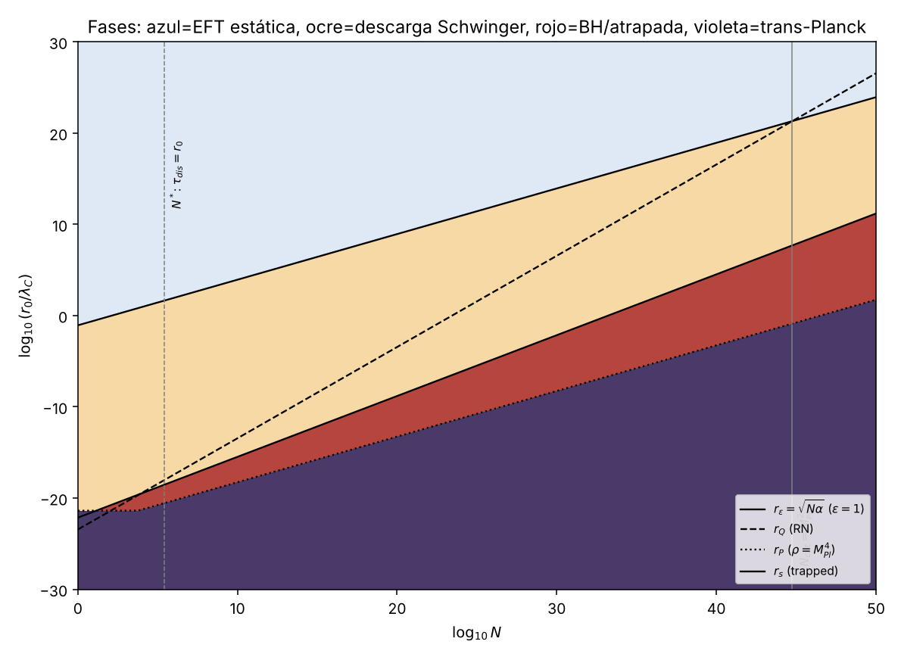
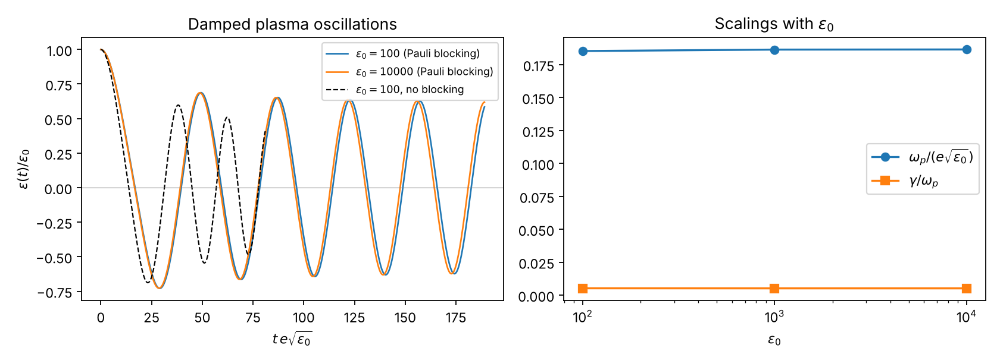
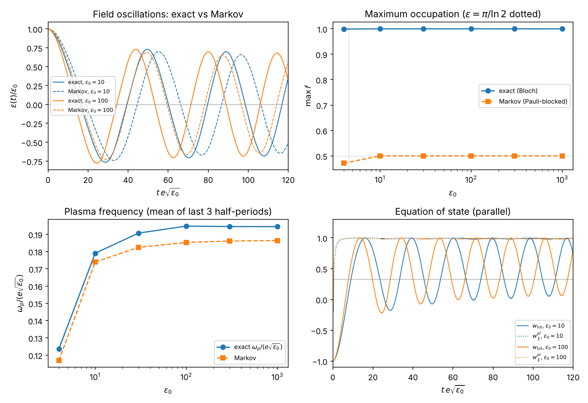
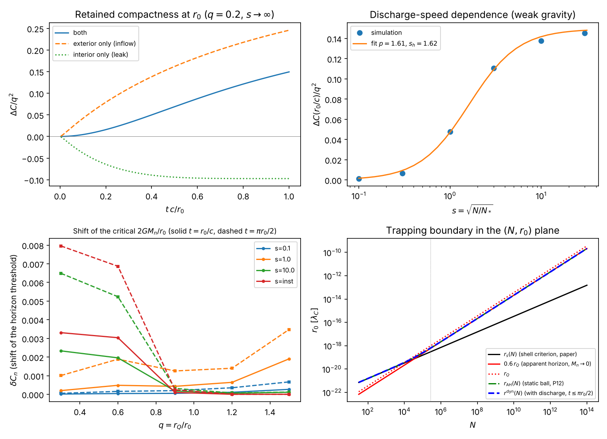
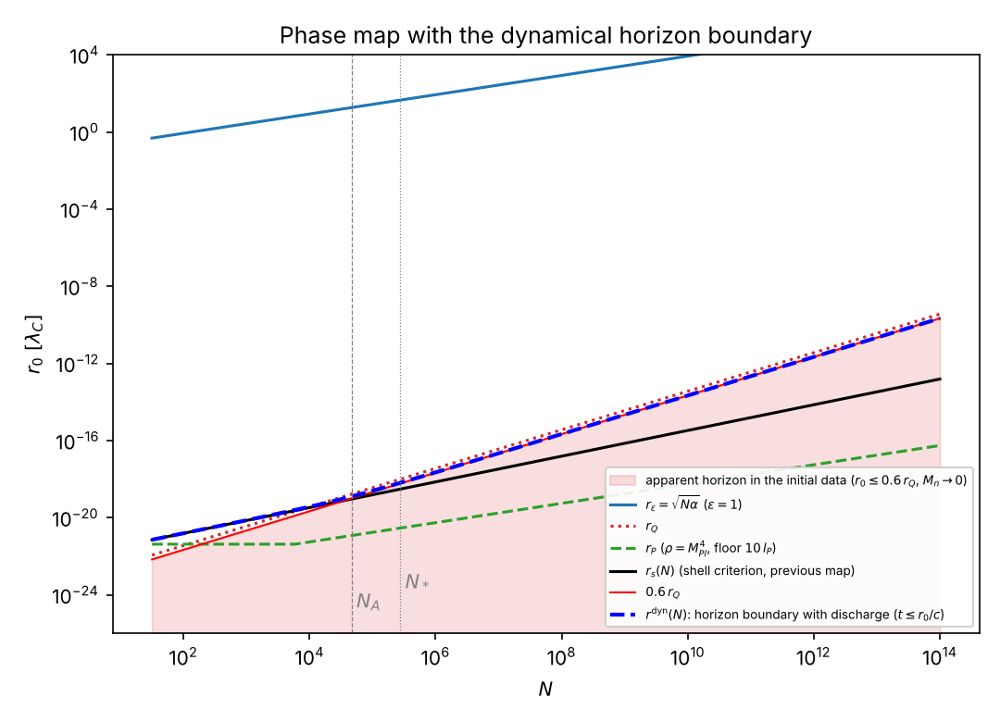

# Destino del campo eléctrico extremo más allá de la ruptura de la EFT estática
### Descarga de Schwinger, QED no perturbativa y atrapamiento gravitatorio en el sistema Einstein–Maxwell–Euler–Heisenberg

> Informe generado por `07_make_report.py`. **Todo número procede de `discovery_results.json` / `results.json`** (si una clave falta, la generación falla). Cada tesis cita el *gate* que la verifica (`04_*`, `05_*`, `06_*`); el total es ⟦meta.n_gates⟧ gates, todos PASS, de los cuales ⟦meta.n_negative_controls⟧ son controles negativos que **deben** detectar un modelo alterado. Unidades: ħ=c=ε₀=m_e=1, longitudes en λ_C, ε ≡ eE/m_e², G=1/M_Pl².

## Abstract

La línea base (`03_integrate.py`) mostró que la EFT de Euler–Heisenberg truncada falla en ε=1 con ρ ≈ ⟦base.rho_over_Pl|.2e⟧ M_Pl⁴, muy por debajo de Planck. Aquí se estudia qué ocurre más allá de ese punto con tres herramientas: (A) el Lagrangiano de Euler–Heisenberg a un bucle con **tiempo propio exacto** (parte real e imaginaria), (B) una cinética de pares con retroacción en el régimen de campo localmente constante, y (C) el criterio de atrapamiento de la desigualdad de Penrose cargada. Resultados: (1) la QED a un bucle **no satura** el campo: crece logarítmicamente, `L = (E²/2)[1 − (α/3π) ln ε + …]`, y el polo de Landau está en log₁₀ ε_L = ⟦branch_A.Landau.log10_eps_L|.0f⟧, frente a log₁₀ ε_Planck = ⟦branch_A.Landau.log10_eps_Planck|.1f⟧: es inaccesible. El perfil interior es Reissner–Nordström con carga corrida (δr₊/r₊ = ⟦branch_A.QED_horizon_shift.measured|.3e⟧ medido vs ⟦branch_A.QED_horizon_shift.predicted_running_charge|.3e⟧ predicho), no el horizonte único tipo Schwarzschild que producen la extrapolación cuártica y Born–Infeld. (2) La descarga neutraliza el campo en **τ_discharge = κ/(e√(eE₀))**, κ = ⟦branch_B.scaling.kappa_inf|.4f⟧, exponente medido ⟦branch_B.scaling.tau0_exponent|.5f⟧. (3) En el criterio de Penrose cargada la energía electrostática de un cascarón **se cancela exactamente**: atrapar exige masa no electromagnética, G·M_n ≥ R/2. De ahí se sigue que **la QED no es un censor universal del colapso**: no puede deshacer una superficie atrapada ni crearla desde energía de campo puro; lo que sí hace es destruir la carga neta en τ_dis, siempre más rápido que la caída libre de N masas en reposo para r₀ ≫ r₀* = ⟦branch_C.race_law.r0_star_over_lPlanck|.2e⟧ l_P. (4) Con bloqueo de Pauli (Markov) el campo oscila durante ≥5 periodos con ω_p = ⟦branch_B2.scaling.omega_over_esqrtx0.2|.3f⟧ e√(eE₀), γ/ω_p = ⟦branch_B2.scaling.gamma_over_omega.2|.4f⟧ y energía conservada a ⟦branch_B2.sweep.10000.Emax_err|.0e⟧. (4b) **La cinética cuántica exacta (05c: Bloch/Bogoliubov acoplada a Maxwell, sin fuente ad hoc) elimina el techo f≤½ de Markov**: f_max = ⟦branch_B3.exact_sweep.100.fmax|.6f⟧ (ε₀=100) frente a ⟦branch_B3.markov_sweep.100.fmax|.3f⟧; el primer cero llega ⟦branch_B3.pct_tau0_shift_1000|.0f⟧ % antes (τ₀·e√ε₀ = ⟦branch_B3.exact_sweep.1000.tau0_e_sqrtx0|.2f⟧ vs ⟦branch_B3.markov_sweep.1000.tau0_e_sqrtx0|.2f⟧, a ε₀=10³), ω_p = ⟦branch_B3.scaling.omega_over_esqrtx0.3|.4f⟧ e√(eE₀) (+⟦branch_B3.pct_omega_shift_1000|.1f⟧ % sobre Markov), γ/ω_p ≈ ⟦branch_B3.scaling.gamma_over_omega.3|.4f⟧, y el plasma de pares es un gas **colineal** (⟨w∥⟩ = ⟦branch_B3.exact_sweep.1000.w_pl_avg_last_period|.3f⟧, no 1/3). Se detectó además un factor 2 en el acoplo del encargo (C11). (5) La igualdad de Penrose cargada se **deriva dentro del repositorio** (θ₊=0 ⇔ 2GM_MS=R; M_ADM=M_MS+U_C; gate P10) para datos simétricos en el tiempo. (6) **Brecha espacial/gravitatoria (06b):** el balance de Misner–Sharp con K_ij≠0 se demuestra en SymPy (`∂_tM=−4πr²F_flux`; la conversión interna campo→plasma no cambia M); en un solver 1+1D la fuga por r₀ retira solo una fracción ⟦branch_C2.weak_gravity_F.inst.f_esc_interior|.2f⟧ de la energía de campo interior mientras el inflow del campo exterior aporta ⟦branch_C2.inflow_over_leak|.1f⟧ veces más (neto: ganancia), y el umbral de horizonte se desplaza <⟦branch_C2.threshold_range_pct|.1f⟧ % hasta r₀/c; la energía de campo interior **estática** coloca la frontera real en r₀≈0.6 r_Q y deja la curva r_s(N) dentro del horizonte aparente inicial para N>⟦branch_C2.N_A_staticcurve_enters_initial_horizon|.1e⟧. Se dan el diagrama de fases en (N, r₀) y las leyes de escala. Lo que **no** se resuelve (colisiones/isotropización, transporte espacial, comparación con curvas publicadas) se declara en §6. **Novedad:** ver `NOVELTY_AUDIT.md`; L1 (masa de Misner–Sharp), la escala de plasma, el crecimiento logarítmico y la violación de DEC (anomalía de traza) son resultados conocidos que aquí se reproducen y verifican formalmente; el valor del trabajo es de síntesis cuantitativa y verificación, no de descubrimiento.

## 1. Línea base y qué pregunta queda abierta

`03_integrate.py` integró el sistema cuártico hacia el centro y se detuvo por ε≥1 (o por escala de variación del campo < λ_C) sin llegar a Planck. Dos hechos se heredan: N_crit = M_Pl²/m_e² = ⟦branch_C.critical.N_crit|.3g⟧ (gate **P5**, simbólico: r_Q = r_ε) y ningún horizonte RN cae dentro de la EFT estática si N < N_crit. La pregunta es qué hay en r < r_stop.

*Corrección de rotulado heredado:* `eeh.py:schwinger_rate` es Γ_vac = 2 Im L₁ (decaimiento del vacío, todos los términos de la serie positivos para espinores), **no** el número medio de pares, que es sólo el término n=1 (`qed1loop.pair_rate`). Los criterios de parada del baseline no cambian (usan ε), pero el modelo dinámico usa la tasa correcta. Verificado: gate **N1** (04): |Im L₁(rayo)/serie de Schwinger − 1| < 10⁻⁸.

## 2. Formulación Lagrangiana y cinética

### 2.1 Electrodinámica no lineal estática acoplada (Rama A)
Para **cualquier** L(E) (E=√(g/f)Φ′; X=−2E²), el CAS deriva (`04`, gates **S1–S4**): `T^t_t = T^r_r = −ρ`, `ρ = E L′ − L`, `p_⊥ = T^θ_θ = L`; la primera integral de Maxwell `r² L′(E) = Q/4π`; `y′ = 8πG r² ρ` con f=g=1−y/r (**S2**); y la conservación `ρ′ + (2/r)(ρ+p_⊥) = 0` (**S4**). El control **C1** confirma que un tensor erróneo (p_⊥=L/2) deja residuo −L/r ≠ 0.

Modelos comparados: Maxwell (RN); Euler–Heisenberg cuártico; **QED a un bucle exacto**
`L₁(x) = −(1/8π²) ∫₀^∞ ds/s³ e^{−s}[ x s cot(x s) − 1 + (x s)²/3 ]`, x=eE=ε, evaluado sobre el rayo s=ρe^{−iπ/4} (los polos de cot están en el eje real); y Born–Infeld calibrado `b² = 1/(32c)` (**S5**). Verificaciones: el desarrollo en x reproduce `4cE⁴` con c=α²/90 (**S6**, simbólico) y la correspondencia ε≪1 con el baseline es L₁/(4cE⁴)−1 ∝ ε^2.00 (**N2**); Im L₁ coincide con la serie de Schwinger a ~10⁻¹⁴ (**N1**); la pendiente de campo fuerte es −1/(24π²) con deriva de la constante K=⟦branch_A.Landau.K_asym|.6f⟧ < 10⁻⁹ (**N3**).

### 2.2 Cinética de pares con retroacción (Rama B)
Campo homogéneo, x=eE(t), aproximación de campo localmente constante:

`ẋ = −2e² [ ∫₀ᵗ dt′ Γ(x′)⟨v⟩ + Γ(x)⟨m_⊥⟩/x ]`, `p(t,t′)=∫_{t′}ᵗ x dt″`, `v=p/√(p²+m_⊥²)`, `m_⊥²=1+x s/π` (s~Exp(1), 8 nodos Gauss–Laguerre, **N0**), `Γ(x)=x²/(4π³)e^{−π/x}`.

El primer término es la corriente de conducción y el segundo la de polarización (energía 2m_⊥ de cada par). El CAS verifica: (**D1**) `∇_μT^{μν}_EM = F^ν{}_λ J^λ` en Minkowski esférico con A_t(t,r), A_r(t,r) arbitrarios, de donde `∇_μT^{μν}_matter = −F^ν{}_λ J^λ` si el total se conserva; (**D2**) `d/dt(E²/2 + ρ_pl) = 0` como identidad exacta (Leibniz sobre cohortes). Los controles **C1/C2** (sin j_pol; j_cond con signo invertido) rompen la identidad; **C3/C4** lo detectan en el integrador (|ΔE|/E₀ = 2.9·10⁻² y 1.7·10³³ frente a ~10⁻⁵).

**Validez declarada (05):** hasta el *primer cero* del campo (las cohortes no se recruzan: sin bloqueo de Pauli); la extensión §2.2b (`05b`) lo levanta dentro del modelo de Markov; LCFA con t_form/τ₀ ≈ e/κ = ⟦branch_B.scaling.lcfa_e_over_kappa|.3f⟧ ≪ 1 (**N5**); región ≥ 3 longitudes de formación ⇒ N ≥ 9/α = ⟦branch_B.race.N_valid_homog|.0f⟧.

### 2.2b Extensión cinética con bloqueo de Pauli a través de múltiples cruces (`05b_plasma_oscillations.py`)
Malla en momento canónico P y momento transversal p_⊥ (Gauss–Legendre), con ocupación f(P,p_⊥,t) y momento cinético p=P+Φ(t), Φ̇=x:

`∂ₜf = (1−2f) S`, `S = |x| e^{−π m_⊥²/|x|} G_σ(p)`, `ẋ = −2e²[ Σ W f p/ω + Σ W ω (1−2f) S / x ]`, `ρ_pl = 2 Σ W f ω`.

El CAS verifica (**K1**) que `d/dt(E²/2+ρ_pl) = 0` es una identidad exacta *con* el factor (1−2f) también en la corriente de polarización (el control **C5** muestra que omitirlo deja el residuo −4ω S f ≠ 0), y (**K2**) que el bloqueo de Markov resuelve `f=(1−e^{−2∫S})/2 ∈ [0,½)`: **desde el vacío f no supera ½**. Esto es una **limitación del modelo**: la QKE exacta de campo constante da f=e^{−π m_⊥²/ε}, que supera ½ para ε>4.5 y p_⊥→0 (la regla de un cruce es f=(1−e^{−2f₀})/2; para f₀=0.9 da ⟦branch_B2.single_crossing.ratio_at_f0_0p9|.2f⟧ de la ocupación exacta). Integrador adaptativo DOP853 con eventos de cruce por cero.

### 2.2c Cinética cuántica exacta no markoviana (`05c_quantum_vlasov_exact.py`)
Para cada modo (P, s=p_⊥²), `p=P+Φ(t)`, `Φ̇=x=eE`, `m_⊥²=1+s`, `ω=√(p²+m_⊥²)`, el sistema de Bloch/Bogoliubov exacto de Dirac en E(t) homogéneo es

`ḟ = (λ/2) u`, `u̇ = λ(1−2f) − 2ω v`, `v̇ = 2ω u`, `λ = x m_⊥/ω²`, `ẋ = −2e² Σ W [ (p/ω) f + (m_⊥/(2ω)) u ]`,

con `ρ_pl = 2 Σ W ω f` y `P_∥ = Σ W p [2(p/ω) f + (m_⊥/ω) u]` (Hellmann–Feynman). **Sin** fuente ad hoc, **sin** LCFA y **sin** ancho σ. Gates simbólicos: **Q0** deriva las ecuaciones desde `n' = 2h×n` con `H = pσ_z + m_⊥σ_x` (y la velocidad y la energía sustraídas del vacío); **Q1** `d/dt[(1−2f)²+u²+v²] = 0` idénticamente ⇒ desde el vacío `0≤f≤1` sin truncar en ½ (control **C9**: sin el ½ de `ḟ` la pureza se rompe); **Q2** `d/dt(E²/2+ρ_pl) = 0` idénticamente (control **C10**: sin la corriente de polarización el residuo es `W x m_⊥ u/ω ≠ 0`); **Q4** identidad de traza `ρ−P_∥−2P_⊥ = Σ W m²(2f−pu/m_⊥)/ω`; **Q3a** `f=½ ⇔ ε = π/ln2 = ⟦branch_B3.x_cross|.5f⟧`. Numéricamente, **Q3** el integrador reproduce `f_∞ = e^{−πm_⊥²/eE}` con error relativo ≤ ⟦branch_B3.lz_max_rel_err|.1e⟧ en ⟦branch_B3.n_lz_cases⟧ casos (hasta f=⟦branch_B3.lz_fmax|.4f⟧ > ½), y **Q3b** el núcleo C (RK4, OpenMP) hasta ⟦branch_B3.kernel_lz.rel_err|.1e⟧.

**Corrección al encargo (hallazgo propio, gate C11):** el acoplo escrito en el encargo, `ḟ=(eE m/ω²)u`, `u̇=(2eE m/ω²)(1−2f)−2ωv`, es el doble del derivado en Q0. Conserva pureza y energía (con la corriente `2e[(p/ω)f+(m/ω)u]`), así que Q1/Q2 **no** lo distinguen, pero **no** reproduce Schwinger–Nikishov: a eE=10, m_⊥=1 da f_∞ = ⟦branch_B3.landau_zener_literal_factor2.f_num.x10_eps2_1|.4f⟧ en vez de ⟦branch_B3.landau_zener.x10_eps2_1.f_exact|.4f⟧. En el plasma acoplado el factor 2 desplaza τ₀·e√ε₀ a ⟦branch_B3.literal_factor2_plasma.tau0_e_sqrtx0|.2f⟧ (control **C14**). El signo del residuo de C10 para c=2 también difiere del escrito (el residuo de dE_tot/dt sin esa corriente es `+2eE m_⊥ u/ω` por modo).

### 2.3 Criterio de atrapamiento (Rama C)
**Demostración interna (sin teoremas externos), gate `P10_misner_sharp_symbolic` (⟦branch_C.P10_n_parts⟧ subcomprobaciones):** (a) en coordenadas de doble nulo `ds²=−2e^{2σ}du dv+R²dΩ²`, con `M_MS=(R/2G)(1−g^{ab}∂ₐR∂_bR)`, SymPy establece `1−2GM_MS/R = −(R²e^{−2σ}/2) θ_ℓ θ_n`: **θ₊=0 ⇔ 2G M_MS = R** y la superficie atrapada es 2G M_MS>R; (b) para datos simétricos en el tiempo (K_ij=0) el vínculo hamiltoniano sale de calcular `G_{ab}n^an^b = 2G m′/r²`, **independiente de las segundas derivadas temporales**, es decir `m′=4πr²ρ`; (c) la ley de Gauss `r²E_orth=cte` es independiente de la métrica, así que `M_ADM = M_MS(R) + ∫_R^∞ 4πr²ρ_EM dr = M_MS(R) + Q²/(8πR)` y la métrica exterior *resulta* Reissner–Nordström; (d) en θ₊=0, `G M_ADM = (R + r_Q²/R)/2` (igualdad de Penrose cargada **derivada**) y con `M_MS(R)=M_n` el término electrostático se cancela idénticamente: `G(M_n+U_C) − (R+r_Q²/R)/2 = G M_n − R/2`; la materia exterior sin carga con ρ≥0 sólo suma masa (desigualdad). El control **C4** confirma que un factor erróneo en M_MS, en el vínculo (m′=2πr²ρ) o en U_C se detecta.
**Alcance probado:** datos esféricos simétricos en el tiempo, ρ≥0, sin materia cargada exterior a la superficie. **No probado aquí:** el caso dinámico general (ecuaciones de Misner–Sharp completas) ni la persistencia posterior de superficies atrapadas.
**Corrección exacta a un bucle de U_C (gate `P11_U_QED_exacta`):** `U_QED(R) = 2π a^{3/2} ∫₀^{D_R} H(D) D^{−5/2} dD`, `H=E D−L` exacta a un bucle, con `U_QED/U_C − 1 = ⟦branch_C.U_QED.table.1e+00.delta_U|.3e⟧` en R=r_Q (N=10⁶) y concordancia con la integral directa en r de ⟦branch_C.U_QED.table.1e+00.rel_diff_direct|.1e⟧; la pendiente respecto de ln ε es ⟦branch_C.U_QED.slope_low|.4e⟧ (ln ε∈[9,23]) → ⟦branch_C.U_QED.slope_dU_dlnx|.4e⟧ (ln ε∈[18,60]) frente a α/3π=⟦branch_C.U_QED.slope_expected_alpha_over_3pi|.4e⟧ (el exceso es el logaritmo subdominante O(α ln ε)). Con Maxwell se recupera Q²/(8πR) y con el término cuártico la corrección −16πc a⁴/(5R⁵) (la usada en 04).
Con N electrones confinados (masa en reposo + energía de Fermi ultrarrelativista) el radio de atrapamiento es la raíz positiva `r_s(N)` de `r = 2G(N + (3/4)(9π/4)^{1/3}N^{4/3}/r)` (**P4**).

### 2.3b Balance de Misner–Sharp dinámico (K_ij ≠ 0) y transporte radial (`06b_dynamical_trapping_1d.py`)
Sin simetría temporal, métrica `ds² = −e^{2φ(t,r)}dt² + e^{2λ(t,r)}dr² + r²dΩ²`, `M_MS = (r/2G)(1−e^{−2λ})`. **D_MS1** (Einstein completo en SymPy): `∂_r M = 4πr²ρ` y `∂_t M = 4πr² T^r_t = −4πr² F_flux`; además `K^r_r = −e^{−φ}∂_tλ ∝ T^r_t` y `K^θ_θ = 0`, de modo que **K_ij≠0 ⇔ flujo≠0** (el caso de P10 es el de flujo nulo). **D_MS2**: con `T=T_EM+T_pl`, `∇_μT^μ_ν(EM)=F_νλJ^λ` (comprobado en la métrica dinámica; su componente t es `−∂_t(E²/2)`) y `∇T(pl)=−FJ`, los vínculos G^r_t y G^r_r−G^t_t dan `∂_tρ_tot = r⁻²∂_r(r²T^r_t)` **independiente** de la transferencia: la conversión interna campo→plasma conserva M_MS y `∂_tM(t,R)=4πR²T^r_t(R)` depende solo del flujo en r=R (`T^r_t(EM)=0`). **C_MS** (control): con transferencia `(1+δ)FJ` aparece la fuente espuria de volumen `4π δ ∫₀ᴿ r² FJ dr ≠ 0`. **D_MS3**: `dM/dt|_{r=R(t)} = 4πR²(T^r_t+Ṙρ)`, nulo para materia comóvil. **D_MS4**: flujos nulos radiales en la métrica dinámica, `∂_tW_± ± ∂_r(vW_±) = ∓…` (ver paper, Eqs. null1–null2), con `v=α/a`; **D_MS5**: el esquema (transporte + conversión con balance) preserva el vínculo de momento; la materia «mantenida» (estática, p=0) lo viola en `4πG r⁴ρ_mat v(ρ_−−ρ_+)/(r−2GM)` ⇒ se trata como **masa de prueba** (sistemático declarado). **P12**: para una bola uniforme de radio r₀ con `q=r_Q/r₀`, `C(x)=[C_n+1.2q²−q²/x]/x`; con C_n=0 hay horizonte aparente en los datos iniciales si `q ≥ ⟦branch_C2.P12.q_crit_Cn0|.4f⟧` (`r₀ ≤ ⟦branch_C2.P12.r0_over_rQ|.2f⟧ r_Q`), la cota de extremalidad `M_ADM ≥ Q`.

## 3. Leyes de escala y resultados deducidos

**L1 (Cancelación de Coulomb).** El atrapamiento de un cascarón cargado no depende de Q: exige G M_n ≥ R/2 (P2, P3). *Corolario:* una superficie atrapada formada sólo con energía de campo es imposible (`verdict.pure_field_trapped_possible = ⟦branch_C.verdict.pure_field_trapped_possible⟧`). La razón carga/masa de N electrones es z² = α M_Pl² = ⟦branch_C.critical.z2_coulomb_over_gravity|.3g⟧ veces la extremal, y una carga unitaria extremal pesaría ⟦branch_C.critical.M_ext_per_charge_me|.3g⟧ m_e.

**L2 (Tiempo de descarga).** `τ_discharge = κ /(e√(eE₀))` con κ∞ = ⟦branch_B.scaling.kappa_inf|.4f⟧ (dispersión ⟦branch_B.scaling.kappa_spread|.1e⟧ en ε₀∈[10⁶,10¹⁰]); exponente ⟦branch_B.scaling.tau0_exponent|.5f⟧ (**N4**). Convergencia: orden observado ⟦branch_B.convergence.order|.2f⟧ con h, h/2, h/4 (**N1**); método independiente (trapecio implícito) τ₀ = ⟦branch_B.convergence.tau0_trap|.6f⟧ frente a ⟦branch_B.convergence.tau0.1|.6f⟧ (**N2**); la energía discreta se conserva a ⟦branch_B.convergence.resid.2|.1e⟧ (suelo ~10⁻⁵ en el cruce; **N3**). Con E₀ = Q/(4πr₀²) en la superficie, ε₀ = Nα/r₀² y `τ_discharge = κ r₀/(α√(4πN))`: la carrera con la luz es **independiente de r₀**; τ_dis = r₀ en N* = κ²/(4πα²) = ⟦branch_C.critical.N_star|.3g⟧ (**P7**).

**L3 (Carrera con el colapso).** Para el colapso libre de N masas en reposo, τ_ff = (π/2)√(r₀³/2GM) (**P8**, integral simbólica), y
`τ_discharge / τ_ff = √(r₀*/r₀)`, `r₀* = 2κ²/(π³α²M_Pl²) = ⟦branch_C.race_law.r0_star_lambdaC|.2e⟧ λ_C = ⟦branch_C.race_law.r0_star_over_lPlanck|.2e⟧ l_P`
(**P9**; **la dependencia en N se cancela exactamente**). Como r₀* ≪ l_P, la descarga es más rápida que la caída libre para todo r₀ físico. En la frontera de atrapamiento r₀=r_s con energía de Fermi incluida, la descarga gana (τ_dis<τ_ff) sólo para N ≳ ⟦branch_C.critical.N_race_at_trap_boundary|.2e⟧; por debajo, el colapso es más rápido, **sin que esto cambie el veredicto** (L1: la carga no entra en el criterio).

**L4 (Rama A: campo fuerte no perturbativo).** `L = (E²/2)[1 − (α/3π)(ln ε + 3K)]` (**S7**, simbólico), polo en `ln ε_L = 3π/α − 3K` (**S8**): log₁₀ε_L = ⟦branch_A.Landau.log10_eps_L|.1f⟧ vs log₁₀ε_Pl = ⟦branch_A.Landau.log10_eps_Planck|.1f⟧, es decir ln ε_L es 12.7 veces ln ε_Pl: **el polo de Landau es inaccesible a un bucle** (ver el límite de Ritus–Narozhny en §6). WEC y NEC se cumplen hasta ε=10⁴⁰ (min ρ/E² = ⟦branch_A.energy_conditions_qed.WEC_rho_min|.3f⟧, min ED/E² = ⟦branch_A.energy_conditions_qed.NEC_ED_min|.3f⟧, **N7**); la SEC (L>0) vale hasta el polo (**N8**); la **DEC se viola** para ε > ⟦branch_A.energy_conditions_qed.DEC_onset_eps_exact|.4f⟧ (umbral exacto = máximo de L₁/x², identidad simbólica **S10**). El margen relativo **no está acotado**: tiende a −α/(3π) = ⟦branch_A.energy_conditions_qed.DEC_margin_asymptote_alpha_over_3pi|.3e⟧ y crece despacio con ln ε (⟦branch_A.energy_conditions_qed.DEC_margin_at.1e+10|.3e⟧ en ε=10¹⁰, ⟦branch_A.energy_conditions_qed.DEC_margin_at.1e+30|.3e⟧ en 10³⁰) hasta divergir en el polo (**N9**). Es la **anomalía de traza** a un bucle (coeficiente β de la QED), física conocida, no un efecto nuevo; el valor ⟦branch_A.energy_conditions_qed.DEC_margin_at_range_edge_1e40|.3e⟧ de versiones previas era el borde de mi rango (ε=10⁴⁰). D′(E) > 0 siempre: no hay pérdida de hiperbolicidad (**N4**).

## 4. Resultados numéricos

### 4.1 Perfil interior del campo y de la métrica (incógnita a)
`L/(E²/2)`: en ε=10 cuártico ⟦branch_A.L_over_Maxwell.10.L_quart_over_Maxwell|.4f⟧ vs QED ⟦branch_A.L_over_Maxwell.10.L_qed_over_Maxwell|.5f⟧; en ε=10⁶, ⟦branch_A.L_over_Maxwell.1e+06.L_quart_over_Maxwell|.3e⟧ vs ⟦branch_A.L_over_Maxwell.1e+06.L_qed_over_Maxwell|.5f⟧; en ε=10³⁰ la QED sigue en ⟦branch_A.L_over_Maxwell.1e+30.L_qed_over_Maxwell|.4f⟧. La truncación α² **sobreestima catastróficamente** la no linealidad.

Métrica con masa M=1.5·M_ext y N=10⁶ (r_Q=⟦branch_A.profiles.1e+06.RN_analitico.rQ|.4g⟧):

| Modelo | horizontes (r₋, r₊) |
|---|---|
| RN (analítico) | ⟦branch_A.profiles.1e+06.RN_analitico.r_minus|.5e⟧, ⟦branch_A.profiles.1e+06.RN_analitico.r_plus|.5e⟧ |
| QED a un bucle | ⟦branch_A.profiles.1e+06.qed.r_h.0|.5e⟧, ⟦branch_A.profiles.1e+06.qed.r_h.1|.5e⟧ |
| EH cuártico extrapolado | único: ⟦branch_A.profiles.1e+06.quartic.r_h.0|.5e⟧ |
| Born–Infeld calibrado | único: ⟦branch_A.profiles.1e+06.bi.r_h.0|.5e⟧ |

El valor único del cuártico y de BI es 2GM (Schwarzschild): ambos eliminan la energía de campo interior. La QED reproduce RN con carga corrida: λ=E/E_Coulomb(r₊)=⟦branch_A.QED_horizon_shift.lam_E_over_Coulomb|.4f⟧ y δr₊/r₊ medido ⟦branch_A.QED_horizon_shift.measured|.3e⟧ vs predicho ⟦branch_A.QED_horizon_shift.predicted_running_charge|.3e⟧ (**N6**). Con N=10²⁰ el patrón se repite (`branch_A.profiles.1e+20`). Resultado: **la no linealidad QED estática no censura el horizonte** (lo desplaza ~1%); la respuesta no puede venir de la estática.

### 4.2 Escalas por número de cargas
@@TABLA_ESCALAS@@
(`06`; r_s con N electrones degenerados; τ_dis/r₀ sólo es aplicable con N ≥ ⟦branch_B.race.N_valid_homog|.0f⟧.)

### 4.3 Diagrama de fases (incógnita c)

Fases en el plano (N, r₀) (fracción del plano explorado entre paréntesis): (0) EFT estática, ε<1 (⟦branch_C.phase_fractions.EFT_estatica|.3f⟧); **(i) descarga de Schwinger** en espacio casi plano, r_P < r₀ < r_ε (⟦branch_C.phase_fractions.descarga_Schwinger|.3f⟧); **(ii) atrapamiento/horizonte**, r₀ ≤ r_s(N) (⟦branch_C.phase_fractions.BH_atrapada|.3f⟧); **(iii) trans-Planck**, ρ_Coul ≥ M_Pl⁴ o r₀<10 l_P (⟦branch_C.phase_fractions.transplanckiana|.3f⟧). Umbrales: N_P=(8πα)^{−1/2}=⟦branch_C.critical.N_P|.3f⟧ (**P6**: ρ(r_Q)/M_Pl⁴ = 1/(8παN²)); atrapamiento sub-planckiano desde N≈⟦branch_C.N_BH_min|.0f⟧ (**N3**); N_crit=⟦branch_C.critical.N_crit|.3g⟧; un BH clásico entra en la EFT estática (r_s>r_ε) sólo para N ≳ α M_Pl⁴/4 = ⟦branch_C.critical.N_classical_BH_in_EFT|.3g⟧ (**N5**). La fase (ii) está **siempre por debajo** de r_ε (ε≫1) y por encima de Planck: el atrapamiento ocurre con densidad sub-planckiana y campo eléctrico supercrítico.

### 4.4 Oscilaciones de plasma con bloqueo de Pauli (`05b`)

Con ⟦branch_B2.sweep.100.n_cross⟧ cruces por cero (≥5 oscilaciones completas) en cada ε₀∈{30, 10², 10³, 10⁴}: **energía discreta conservada a ⟦branch_B2.sweep.10000.Emax_err|.1e⟧ (peor caso; límite 10⁻⁴; K5)**; la ocupación cumple 0≤f≤⟦branch_B2.sweep.100.fmax|.6f⟧<½ (K4), mientras que *sin* bloqueo llega a f=⟦branch_B2.pauli_effect_x100.f_max_noblock|.2f⟧ (>1: violación de Pauli). El bloqueo alarga el primer cero de τ₀=⟦branch_B2.pauli_effect_x100.tau0_noblock|.4f⟧ a ⟦branch_B2.pauli_effect_x100.tau0_block|.4f⟧ (ε₀=100), y sin él el modelo reproduce el de cohortes de 05 (K3, diferencia 10⁻⁴). **Frecuencia de plasma:** ω_p = ⟦branch_B2.scaling.omega_over_esqrtx0.2|.4f⟧ e√ε₀ con exponente ⟦branch_B2.scaling.omega_exponent|.3f⟧ en ε₀ (K7); **amortiguamiento:** γ/ω_p = ⟦branch_B2.scaling.gamma_over_omega.2|.4f⟧, es decir **muy débil** y también invariante de escala (el bloqueo frena la conversión de campo en pares; la amplitud cae del ⟦branch_B2.sweep.100.amps.0|.2f⟧ al ⟦branch_B2.sweep.100.amps.8|.2f⟧ del valor inicial en 9 semiciclos). Convergencia: rtol (10⁻⁹→10⁻¹¹), dp÷1.5 y J=10→14 cambian τ₀ en ≤⟦branch_B2.convergence.max_rel_change_tau0|.1e⟧ y ω en ≤⟦branch_B2.convergence.max_rel_change_omega|.1e⟧ (K6); el ancho de la fuente σ∈[0.15,0.40]√ε₀ cambia τ₀ en ≤⟦branch_B2.sigma_sensitivity.max_rel_change_tau0|.1e⟧. Los controles C6 (j_pol sin (1−2f): |ΔE|/E₀=⟦branch_B2.controls.C6_energy_err|.1e⟧), C7 ((1+2f): f=⟦branch_B2.controls.C7_fmax|.0f⟧≫½) y C8 se detectan.

### 4.5 Cinética exacta frente a Markov (`05c`)

@@TABLA_EXACTA@@

**Convergencia y controles.** Malla en (P, p_⊥²) con ΔP=0.04√ε₀, 30 nodos de Gauss–Legendre, RK4 de paso 0.2/ω_max, ⟦branch_B3.exact_sweep.100.N_modes⟧ modos a ε₀=100. Energía discreta conservada a ⟦branch_B3.max_energy_err|.1e⟧ (peor caso; ≥5 oscilaciones en ε₀≥10, 2 en ε₀=4; **Q2b**). Variaciones de τ₀ bajo ΔP/2, J×2, Δt/2 y P_a+30 %: ⟦branch_B3.convergence.max_rel_change_tau0|.1e⟧; semiperiodos 1–4: ⟦branch_B3.convergence.max_rel_change_halfperiods_1to4|.1e⟧ (**K6**); ε₀=10 con J×2: ⟦branch_B3.convergence.eps10_max_rel_change|.1e⟧. Estado inicial: vacío adiabático de orden cero frente al superadiabático de 1.er orden → variación máx. ⟦branch_B3.init_sensitivity.max_rel_change|.3f⟧ (**K8**). Pureza numérica: media ponderada ⟦branch_B3.purity_numeric.weighted_mean_dt|.1e⟧ (Δt) y ⟦branch_B3.purity_numeric.weighted_mean_dt_half|.1e⟧ (Δt/2), error de fase/amplitud de RK4 en modos de ω alto que cae como Δt⁵ (**Q1d**). Controles: sin corriente de polarización |ΔE|/E₀ = ⟦branch_B3.controls_C13_energy|.1e⟧ (**C13**); malla estrecha detectada (**C12**).

**Resultados.** (i) *Ocupación:* f_max = ⟦branch_B3.exact_sweep.100.fmax|.6f⟧ (ε₀=100) y ≥ ⟦branch_B3.min_fmax_ge10|.5f⟧ para todo ε₀≥10, frente a ≤ ½ de Markov; incluso a ε₀=4<π/ln2, la interferencia entre cruces llega a f_max = ⟦branch_B3.exact_sweep.4.fmax|.4f⟧ (Markov: ⟦branch_B3.markov_sweep.4.fmax|.3f⟧). El déficit de la regla de Markov en un cruce es ⟦branch_B3.markov_single_crossing_deficit.at_f0_0p9|.3f⟧ a f₀=0.9 (el «54 %» del encargo; **D1**) y ⟦branch_B3.markov_single_crossing_deficit.limit_f0_1|.3f⟧ en el límite. (ii) *Primer cero:* τ₀·e√ε₀ exacto/Markov = ⟦branch_B3.comparison.1000.tau0_ratio_exact_over_markov|.3f⟧ (ε₀=10³), ⟦branch_B3.comparison.10.tau0_ratio_exact_over_markov|.3f⟧ (10), ⟦branch_B3.comparison.4.tau0_ratio_exact_over_markov|.3f⟧ (4). El valor exacto está a ⟦branch_B3.tau0_vs_kappa_pct|.1f⟧ % de κ=⟦branch_B.scaling.kappa_inf|.2f⟧ (fuente de Markov **sin** bloqueo, 05): el alargamiento de τ₀ atribuido en 4.4 al bloqueo de Pauli es un **artefacto del techo f≤½**. (iii) *Frecuencia de plasma:* ω_p ∝ ε₀^⟦branch_B3.scaling.omega_exponent|.3f⟧, ω_p/(e√ε₀) = ⟦branch_B3.scaling.omega_over_esqrtx0.3|.4f⟧ (ε₀=10³; Markov ⟦branch_B3.scaling.omega_over_esqrtx0_markov.3|.4f⟧, +⟦branch_B3.pct_omega_shift_1000|.1f⟧ %), **K7**. (iv) *Amortiguamiento:* γ/ω_p = ⟦branch_B3.scaling.gamma_over_omega.3|.4f⟧ (exacto) vs ⟦branch_B3.comparison.1000.gamma_over_omega_markov|.4f⟧ (Markov); la amplitud decae lenta y **no exponencialmente** (⟦branch_B3.exact_sweep.1000.amps.0|.2f⟧→⟦branch_B3.exact_sweep.1000.amps.5|.2f⟧ en seis semiciclos), con diez amplitudes el ajuste es solo descriptivo y la diferencia con Markov no es significativa. (v) *Ecuación de estado (Q6):* `w_tot=(P_∥−E²/2)/(ρ_pl+E²/2)` vale exactamente −1 en t=0 y cruza 0 en t·e√ε₀ = ⟦branch_B3.eos.1000.t_cross0|.2f⟧ (⟦branch_B3.eos.30.t_cross0|.2f⟧ a ε₀=30; ⟦branch_B3.eos.4.t_cross0|.2f⟧ a ε₀=4), antes del primer cero (⟦branch_B3.exact_sweep.1000.tau0_e_sqrtx0|.1f⟧). El plasma de pares tiene `w_∥^pl=P_∥/ρ_pl` > 1/3 desde el primer instante y su promedio en el último periodo es ⟦branch_B3.exact_sweep.1000.w_pl_avg_last_period|.3f⟧ (máximo instantáneo ⟦branch_B3.max_wpl|.3f⟧; el exceso sobre 1 es el término coherente): tiende al valor **colineal 1, no al isótropo 1/3**, porque los pares se crean con `p_⊥² ∼ ε/π ≪ p_∥²` y el modelo homogéneo no tiene colisiones ni dispersión transversal que los isotropice. La transición a ⟨w⟩→1/3 pedida en el encargo no ocurre en este modelo y requeriría colisiones o transporte.

### 4.6 Descarga espacialmente resuelta y atrapamiento (`06b`)

**Solver 1+1D** en calibre polar-areal (r₀=c=1; `q=r_Q/r₀`, `s=√(N/N*)`): campo de una bola uniforme, conversión local con el reloj `ṡ_c = α κ s √(E/E_sup)` y la curva universal exacta de 05c, reparto 1/2 saliente + 1/2 entrante, métrica de los vínculos. **Validación:** límite plano analítico (incluye el paso por el centro) con error ⟦branch_C2.flat_limit.table.2000.err_out|.1e⟧ / ⟦branch_C2.flat_limit.table.2000.err_in|.1e⟧ y orden observado ⟦branch_C2.flat_limit.observed_orders.2|.2f⟧ (**N1**; control **C_N1**: sin reflexión en r=0 el error es del 3 %); balance `Δm(r₀)=∫(F_in−F_out)dt` con residuo relativo ⟦branch_C2.balance_summary.resmax|.1e⟧ en ⟦branch_C2.balance_summary.n_cases⟧ casos (**N2**; control **C_N2**: plasma con 1.2× lo que pierde el campo ⇒ residuo ⟦branch_C2.control_no_balance.residual|.1e⟧); convergencia (Δr, Δr/2, Δr/4) ≤ ⟦branch_C2.convergence_summary.rel_final_max_consistent|.1e⟧ (**N3**).

**Respuesta a la pregunta abierta** (t = r₀/c, gravedad débil q=0.2, descarga instantánea): el canal *interior* (energía del campo dentro de la bola convertida en plasma que cruza r₀ hacia fuera) retira `ΔC = ⟦branch_C2.weak_gravity_F.inst.interior_only|.4f⟧ q²`, es decir una fracción ⟦branch_C2.weak_gravity_F.inst.f_esc_interior|.3f⟧ de la energía de campo interior (⟦branch_C2.weak_gravity_F.1.0.f_esc_interior|.3f⟧ en s=1) y ⟦branch_C2.loss_fraction_of_UC|.3f⟧ de U_C total; **pero** el canal *exterior* (campo fuera de la bola convertido in situ, cuya mitad entrante cruza r₀) aporta `+⟦branch_C2.weak_gravity_F.inst.exterior_only|.4f⟧ q²`, **⟦branch_C2.inflow_over_leak|.2f⟧ veces más**, de modo que el balance neto es una **ganancia**: `ΔC = +⟦branch_C2.weak_gravity_F.inst.both|.4f⟧ q²` (**N4**). Ley de escala `ΔC ≃ q² F∞ s^p/(s^p+s_h^p)` con F∞=⟦branch_C2.F_scaling.F_inf|.4f⟧, p=⟦branch_C2.F_scaling.hill_p|.2f⟧, s_h=⟦branch_C2.F_scaling.hill_s_half|.2f⟧ (**N8**): régimen instantáneo N≫N*, balístico N≪N* (ΔC/q² = ⟦branch_C2.weak_gravity_F.0.3.both|.4f⟧ en s=0.3). La gravedad suprime el inflow (**N5**): ΔC/q² = ⟦branch_C2.strong_gravity.1.0.inst|.3f⟧ en q=1 y ⟦branch_C2.strong_gravity.1.5.inst|.4f⟧ en q=1.5.

**Umbral de atrapamiento (N6, N7).** Justo bajo el umbral estático de horizonte aparente (P12), la dinámica de descarga eleva el máximo de la compacidad a lo sumo en δC_n = ⟦branch_C2.threshold_response.delta_Cn_max|.4f⟧ (≈⟦branch_C2.threshold_range_pct|.1f⟧ %) para t ≤ r₀/c, 0.1 ≤ s ≤ ∞ y 0.3 ≤ q ≤ 1.5; ningún caso forma un horizonte nuevo. **ΔM_crit/M_crit ≤ ⟦branch_C2.threshold_range_pct|.1f⟧ %.** Lo que sí desplaza la frontera es la energía de campo **interior estática** (q²/5), ausente del criterio de cascarón: la curva `r_s(N)` del mapa anterior cruza `0.6 r_Q` en N_A ≃ ⟦branch_C2.N_A_staticcurve_enters_initial_horizon|.2e⟧ y, para N>N_A, queda **dentro** de la región con horizonte aparente en los datos iniciales (r_AH/r_s hasta ⟦branch_C2.curve_summary.ratio_AH_over_rs_max|.0f⟧ para N≤10¹⁴); la corrección dinámica a r_AH es ≤ ⟦branch_C2.curve_summary.rel_shift_dyn_vs_AH_max|.1e⟧. **Hasta la caída libre:** con un núcleo reflectante r_core = ⟦branch_C2.threshold_response.r_core|.1f⟧ r₀ (momento angular de los rayos, θ⊥≈0.11; conserva la energía a ⟦branch_C2.core_summary.balance_abs_max|.1e⟧, ΔC cambia ⟦branch_C2.core_summary.core_variation_q0p5|.3f⟧ al variar el núcleo 0.05→0.2 en q=0.5; **N10**) la evolución llega a t=(π/2) r₀ y el desplazamiento máximo del umbral es δC_n = ⟦branch_C2.threshold_response.delta_Cn_max_ff|.4f⟧ (⟦branch_C2.threshold_range_pct|.1f⟧ %). La geodésica radial de un elemento neutro en la métrica evolucionada reproduce la cicloide de Schwarzschild a ⟦branch_C2.geodesic_vs_schwarzschild.0.rel_err|.1e⟧ (**N9**). **Cautelas:** el tiempo disponible es el de caída libre PRESCRITO (π/2) r₀ del borde de atrapamiento y la materia no se evoluciona (colapso autoconsistente de un cascarón cargado no resuelto: haría falta su tensión radial y la fuerza de Coulomb); materia como masa de prueba (sistemático ⟦branch_C2.held_matter_systematic.0.rel_gap|.2f⟧–⟦branch_C2.held_matter_systematic.2.rel_gap|.2f⟧ en ΔC); sin explosión de Coulomb de los portadores de carga, sin imponer Gauss durante la conversión, sin colisiones.

## 5. Rutas descartadas (con su evidencia)
1. **Extrapolar el EH cuártico a ε≫1.** E∼r^{−2/3}, ρ∼r^{−8/3}, masa interior finita (**S9**): artefacto; la QED a un bucle da ρ∼r^{−4}.
2. **Born–Infeld como completación de la QED.** Calibrado a b²=1/32c satura en ε=⟦branch_A.eps_BI_saturation|.1f⟧, pero ya a ε=10 el signo de la desviación respecto a Maxwell es opuesto al de la QED (BI ⟦branch_A.L_over_Maxwell.10.L_bi_over_Maxwell|.4f⟧ > 1; QED ⟦branch_A.L_over_Maxwell.10.L_qed_over_Maxwell|.5f⟧ < 1). No es la completación de la QED; se conserva sólo como contraste.
3. **Censura por saturación estática.** Refutada por 4.1 (desplazamiento ~1%).
4. **Densidad de energía de campo puro como fuente de horizonte.** Imposible por L1 (cancelación exacta).

## 6. Límites UV, alcance y problemas abiertos (sin extrapolaciones silenciosas)
- **Frontera de predicción:** el polo de Landau y la densidad de Planck no se cruzan en ningún cálculo; el criterio ρ ≥ M_Pl⁴ / r<10 l_P define la fase (iii) y ahí no se afirma nada.
- **No resuelto:** (0) **brecha espacial/gravitatoria:** resuelta dentro de §2.3b/§4.6 con las cautelas de §4.6; (a) la dinámica tras el primer cero se resuelve ahora con la **QKE de Bloch exacta homogénea** (§2.2c, 05c; ocupaciones hasta f→1, aniquilación coherente), pero **sin colisiones, sin transporte, sin renormalización de la polarización del vacío (sólo orden adiabático cero), con estado inicial = vacío de orden cero (efecto ⟦branch_B3.init_sensitivity.max_rel_change|.3f⟧) y sin comparación con curvas publicadas**; los resultados de Markov (§2.2b) quedan como modelo con techo f≤½; (b) transporte espacial (esfera con perfil, hidrodinámica o Vlasov 1+1) y choques/cruce de flujos; (c) el modelo es plano y homogéneo: la métrica dependiente del tiempo sólo entra por el criterio de atrapamiento y la contabilidad de energía; (d) la hipótesis «la descarga neutraliza completamente la carga neta por debajo de r_neutral ≈ ⟦branch_C.critical.r_neutral_lambdaC|.3f⟧ λ_C» es una **estimación no verificada**; (e) κ tiene incertidumbre sistemática O(1) por LCFA y por usar la tasa de pares de campo constante; los *exponentes* son robustos, los prefactores no.
- **Ritus–Narozhny (omisión corregida tras la auditoría):** la conjetura de que cada lazo aporta αχ^{2/3} (χ≳α^{-3/2}≈1.6·10³ en campo cruzado constante) implica que todo resultado «a un bucle» para ε≫10³ —incluidos WEC/NEC/SEC hasta 10⁴⁰, el polo de Landau y el barrido de 05 hasta ε=10¹⁰— puede alterarse a orden superior; su aplicabilidad a campo eléctrico puro no está verificada.
- **Expansión derivativa:** los perfiles de 04 en r∼r_Q≪λ_C (ℓ≈r_Q/2≪λ_C) violan el criterio derivativo del baseline y omiten los términos de curvatura de Drummond–Hathrell (α(λ_C/L)²); son soluciones *formales* del modelo de campo localmente constante, no predicciones de la QED.
- **Probado internamente (P10, alcance acotado):** igualdad/desigualdad de Penrose cargada para datos simétricos en el tiempo y sin materia cargada exterior. **Citado, no demostrado aquí:** el caso dinámico general y la persistencia de superficies atrapadas bajo NEC. Que un agujero negro cargado pierde carga por Schwinger es el resultado de Gibbons (1975); aquí sólo se comprobó la consistencia cualitativa (τ_dis ∼ r₀ para N≈10⁵–10⁶).
- La fase (ii) usa un modelo de materia (electrones degenerados) que es un *parámetro*: otro M_n desplaza r_s, no la estructura lógica (columna `r_s_ext` en `branch_C.table`).

## 7. Conclusión
Más allá de r_stop no aparece ninguna singularidad ni saturación de origen QED en el régimen calculable: la no linealidad estática crece sólo como α ln ε y el polo de Landau queda 12.7 veces más lejos (en ln ε) que Planck. La pregunta «¿es la QED un censor cuántico universal del colapso?» tiene respuesta **negativa**, con matices precisos: (1) una superficie atrapada exige masa no electromagnética G M_n ≥ R/2; la energía electrostática no cuenta (cancelación exacta, L1); (2) la descarga de Schwinger convierte el campo en un plasma de pares en τ_dis = κ/(e√(eE₀)), conservando energía-impulso, y por tanto no puede reducir M_n ni deshacer una superficie atrapada; (3) lo que **sí** hace la QED es eliminar la carga neta que, por ser z² ≈ 4·10⁴² veces superextremal, impediría por repulsión el colapso de la materia cargada: actúa como *facilitador*, más rápido que la caída libre (L3). La condición real de formación de un horizonte a escalas sub-Compton es de masa, no de carga: N m_e ≳ r₀/2G, es decir N ≳ M_Pl²/2 para r₀=λ_C, que es el N_crit de la línea base reinterpretado.

## Apéndice A. Trazabilidad (gate → script)
@@TRAZABILIDAD@@
## Apéndice B. Referencias (leídas como extractos de búsqueda; no verificadas en texto completo)
- Cinética cuántica del mecanismo de Schwinger y límite de Markov: [Schmidt et al., hep-ph/9809227](https://arxiv.org/pdf/hep-ph/9809227); [hep-ph/9712377](https://arxiv.org/pdf/hep-ph/9712377); [Pair production in a strong electric field, hep-ph/0311293](https://arxiv.org/abs/hep-ph/0311293). Bloqueo de Pauli en campos sobrecríticos: [arXiv:2306.12956](https://arxiv.org/pdf/2306.12956).
- Pérdida espontánea de carga de agujeros negros: Gibbons, Commun. Math. Phys. 44 (1975) 245; [Gabriel, gr-qc/0010103](https://arxiv.org/pdf/gr-qc/0010103).
- Desigualdad de Penrose cargada y superficies atrapadas en simetría esférica: [Malec–Ó Murchadha, gr-qc/9401014](https://arxiv.org/pdf/gr-qc/9401014); [Khuri–Weinstein–Yamada](https://www.math.stonybrook.edu/~khuri/Khuri_Weinstein_Yamada_Cont_Math.pdf); [Kunduri, arXiv:2409.07639](https://arxiv.org/html/2409.07639v1).
- Heisenberg–Euler, Schwinger (1951), Born–Infeld, Oppenheimer–Snyder: citados de memoria (no consultados en esta sesión).
